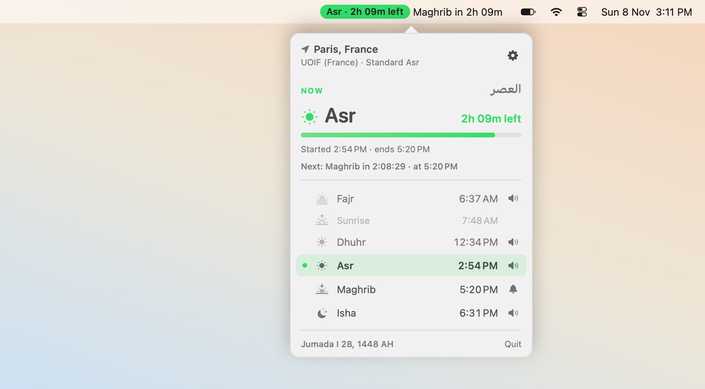
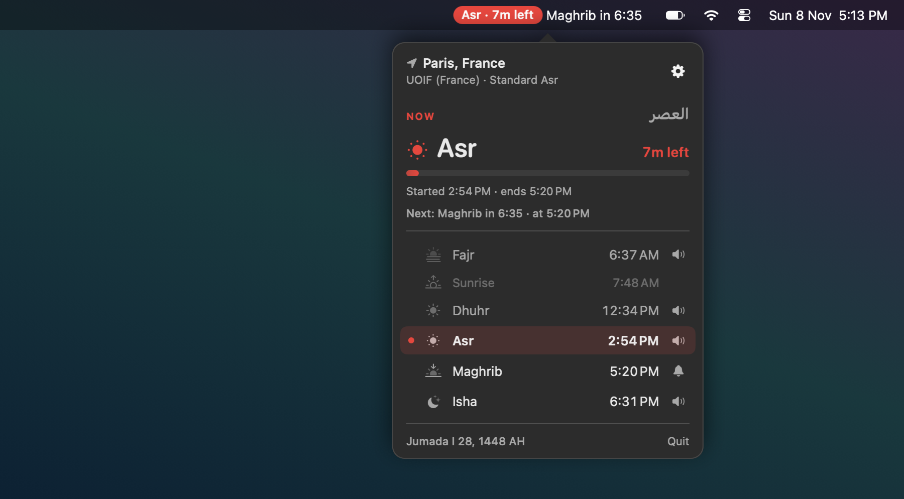
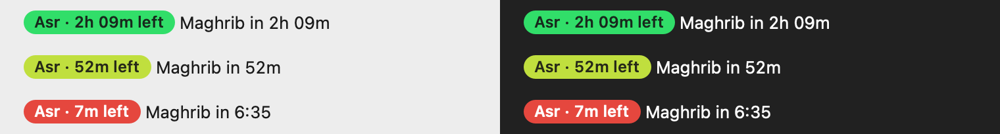
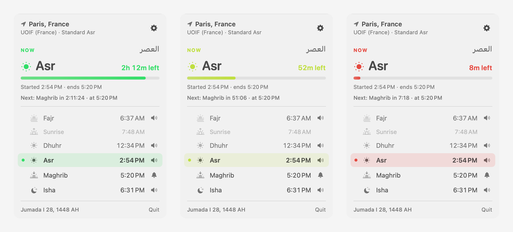
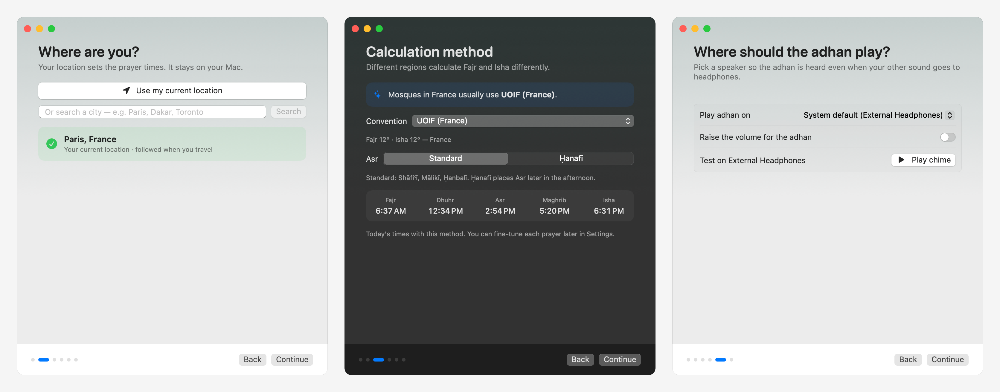
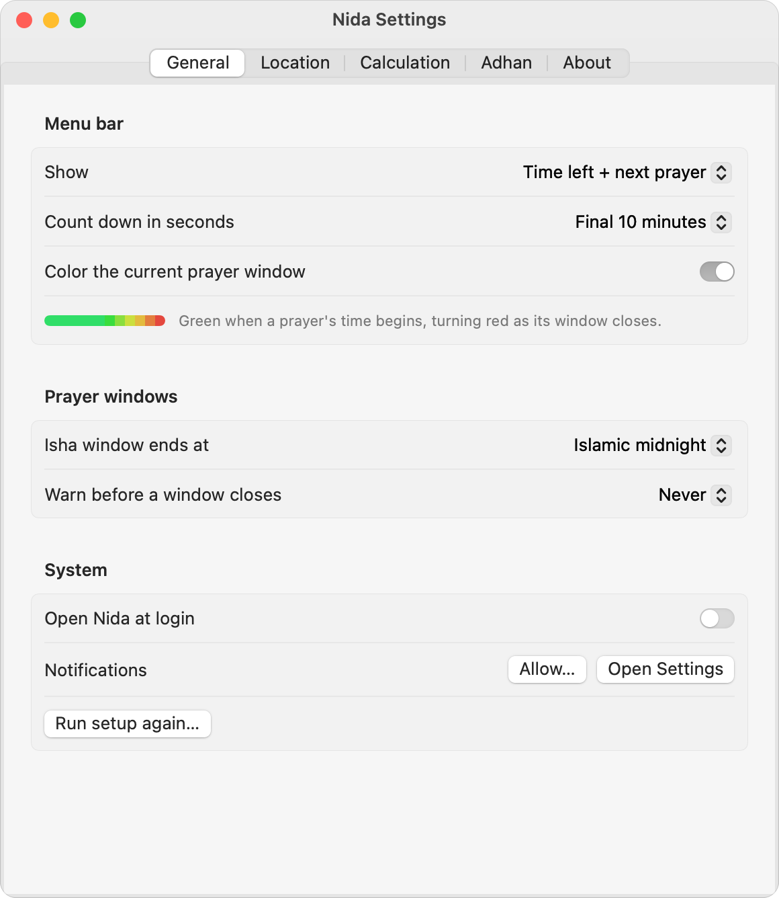
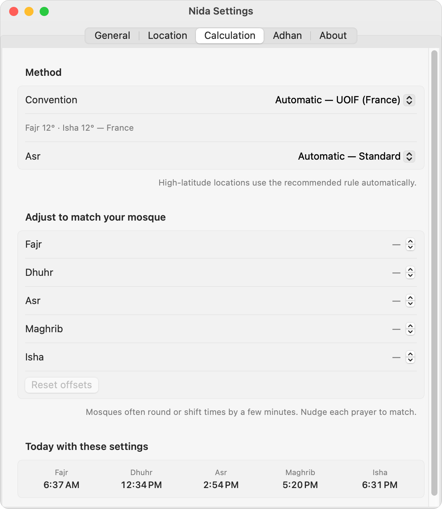
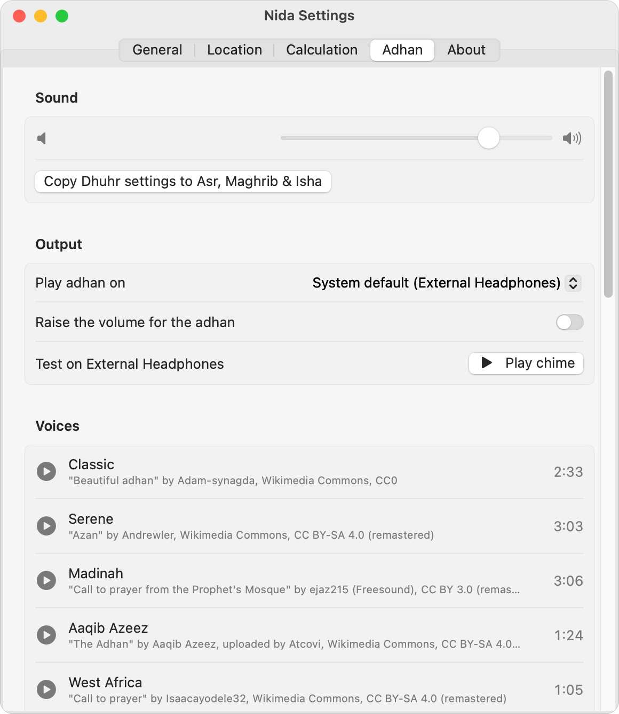

# Nida · نداء

Prayer times in the macOS menu bar, with the adhan at prayer time. Everything is calculated on the Mac
(no API, no account, works offline).

<p align="center">
  
  
</p>

**Download:** the latest DMG is on the [Releases](../../releases/latest) page.

## Features

- **Menu bar**: while a prayer's window is open, a colored pill shows it with the time left (green, through
  amber, to red as it closes), followed by a live countdown to the next prayer. Between windows: the next
  prayer with a countdown. In the final 10 minutes it counts in seconds (configurable). Compact and
  color-only styles too.

  

  

- **Prayer windows**: Fajr→sunrise, Dhuhr→Asr, Asr→Maghrib, Maghrib→Isha, Isha→Islamic midnight (or Fajr).
- **Adhan**: five mastered, freely licensed recordings plus a synthesized chime, or add your own: drop files on
  Settings › Adhan, or use **Find more voices…** (opens Assabile's collection). Imported voices are analyzed
  for phrase breaks and leveled to the built-in loudness, and can be renamed. Each prayer is set up
  separately: adhan / chime / notification only / off, voice, length (full, opening takbīr, ~30 s … ~2 min),
  and a reminder. Shortened adhans stop at a phrase boundary and fade out, so they never cut off mid-word.
- **Output**: always play the adhan on a chosen speaker (e.g. the Mac's speakers while music goes to
  headphones), with fallback to the system default when it's unplugged. Optionally raise and unmute that
  output for the adhan. The previous volume is restored afterwards, unless you changed it yourself meanwhile.
- **Notifications** with a *Stop adhan* action, optional reminders, and an optional "window closing" warning.
- **Location**: automatic (CoreLocation) or city search. 21 conventions, chosen automatically per country
  (UOIF in France, ISNA in North America, Umm al-Qura in Saudi Arabia, Diyanet in Türkiye, JAKIM in Malaysia…),
  with automatic Ḥanafī Asr where it's the norm. Per-prayer minute offsets let you match your mosque.
- **Travel**: re-checks your location on wake, on time-zone change and every few hours. On a move it can
  update automatically, ask first (notification + banner), or do nothing.
- **Anywhere**: high-latitude rules are applied automatically. In polar day or night, times come from the
  nearest latitude where the sun still rises and sets.
- Onboarding on first launch, Hijri date, launch at login.
- **Sleep**: Nida never keeps your Mac awake by default. A sleeping Mac can't run any app, so prayers that fall
  while it sleeps pass silently (no late adhans on wake). Turn on **Keep Mac awake for prayer alerts**
  (Settings › General) to block idle system sleep only: the screen still turns off and locks, and Apple menu ›
  Sleep still works.

  

<p align="center">
  
  
  
</p>

## Always current, very light

- Times are never stored as a timetable. They're calculated on demand from today's date, your location and your
  settings, cached for the day, and recalculated at midnight, at launch, on wake, on a time-zone change, and
  whenever a setting or your location changes.
- Footprint (measured on a Mac mini, macOS 27): **~17 MB** memory and **~0.06% CPU**, waking about once a
  minute, exactly on the minute. Prayer times, reminders and closing warnings all fall on whole minutes, so
  nothing is missed. It only switches to per-second updates while a countdown shows seconds, the popover or a
  window is open, or audio is playing. The popover and windows are released from memory when closed.
- Live seconds in the menu bar: **Final 10 minutes** (default), **Always** or **Never** (Settings › General).
  Every menu bar redraw costs CPU (macOS redraws the item on each display), so "Always" uses about 2% CPU.

## Install and update

Open `dist/Nida-<version>.dmg` and either drag **Nida** into **Applications**, or double-click Nida in the
disk image window: it offers to **Install** (or **Update** an older copy). It then quits the old version,
replaces it and relaunches from Applications. Settings are kept (they live in your user defaults, not in the app).

To change anything after installing: **gear menu › Settings…**, or **gear menu › Run setup again…**. Setup
starts from your current settings and only overwrites what you change in it.

The build is ad-hoc signed. On your own Mac it opens normally. On another Mac, the first launch needs
**right-click → Open** (or System Settings › Privacy & Security › *Open Anyway*), because it isn't notarized.
See *Release* below to notarize it.

## Build

Needs only the Xcode Command Line Tools (full Xcode isn't required), plus `ffmpeg` and `python3` + `numpy`
if you regenerate the audio.

```sh
./scripts/build_app.sh              # → dist/Nida.app (universal: Apple silicon + Intel)
VERSION=1.0.0 ./scripts/make_dmg.sh # → dist/Nida-1.0.0.dmg (drag-to-Applications window)
./scripts/prepare_audio.sh          # re-download and re-master the adhan recordings
swift scripts/make_art.swift build/art   # regenerate icon + DMG background
```

The first DMG build asks once to let Terminal control Finder (that's how the window layout is set).
If you decline, the DMG still works, just without the custom layout.

Debug helpers (debug builds only):

```sh
swift build
.build/debug/Nida --times 48.8566 2.3522 Europe/Paris france 2026-11-08   # print a day's times
NIDA_SOUNDS=Resources/Sounds .build/debug/Nida --snapshot /tmp/nida-shots   # render every screen to PNG
NIDA_SOUNDS=Resources/Sounds .build/debug/Nida --readme docs/screenshots     # regenerate the README images
```

## Release

### Automatic (GitHub Actions)

Push a version tag and `.github/workflows/release.yml` builds the universal app and the DMG on a macOS runner,
then publishes a GitHub Release with the DMG and its SHA-256 checksum attached:

```sh
git tag v1.3.0 && git push origin v1.3.0
```

The tag sets the version (`v1.3.0` → 1.3.0) and the run number sets the build number. **Actions › Release ›
Run workflow** does a test build without publishing: the DMG is attached to the run as an artifact.

Without secrets the release is ad-hoc signed, so the first launch on another Mac needs right-click → Open.
To ship it signed and notarized, add these repository secrets (Settings › Secrets and variables › Actions):

| Secret | What it is |
|---|---|
| `MACOS_CERTIFICATE` | Developer ID Application certificate + key exported as `.p12`, base64-encoded (`base64 -i cert.p12 \| pbcopy`) |
| `MACOS_CERTIFICATE_PASSWORD` | The `.p12` export password |
| `MACOS_SIGN_ID` | e.g. `Developer ID Application: Your Name (TEAMID)` |
| `NOTARY_APPLE_ID` | Your Apple ID email |
| `NOTARY_PASSWORD` | An app-specific password from account.apple.com |
| `NOTARY_TEAM_ID` | Your 10-character team ID |

With only the first three, the release is Developer ID signed but not notarized.

### By hand (notarized)

With an Apple Developer account ($99/yr):

```sh
xcrun notarytool store-credentials nida-notary     # once
SIGN_ID="Developer ID Application: Your Name (TEAMID)" NOTARY_PROFILE=nida-notary \
  VERSION=1.0.0 ./scripts/make_dmg.sh
```

## Roadmap

Planned work (dependency watching with Dependabot, automatic updates through Warden, Warden licence support,
notarized releases) is in [ROADMAP.md](ROADMAP.md).

## Notes

- `@State` is a macro in the macOS 27 SDK and its plugin only ships with full Xcode, so the views use
  `@ViewState` (a typealias for the same property wrapper). See `Sources/Nida/ViewState.swift`.
- Calculated times were cross-checked against the Aladhan API for Makkah, Paris, London, New York, Cairo,
  Karachi, Dakar, Istanbul and Kuala Lumpur: within 0–2 minutes, apart from documented method differences.

## Credits

- Prayer calculation: [Adhan Swift](https://github.com/batoulapps/adhan-swift) by Batoul Apps, MIT.
- "Classic" adhan: *Beautiful adhan* by Adam-synagda, Wikimedia Commons, CC0.
- "Serene" adhan: *Azan* by Andrewler, Wikimedia Commons,
  [CC BY-SA 4.0](https://creativecommons.org/licenses/by-sa/4.0/), remastered (filtered, denoised,
  loudness-normalized). The remastered file is shared under the same licence.
- "Madinah" adhan: *Call to prayer from the Prophet's Mosque* by ejaz215 (Freesound, via Wikimedia Commons),
  [CC BY 3.0](https://creativecommons.org/licenses/by/3.0/), remastered.
- "Aaqib Azeez" adhan: *The Adhan* by Aaqib Azeez, uploaded by Atcovi, Wikimedia Commons, CC BY-SA 4.0, remastered.
- "West Africa" adhan: *Call to prayer* by Isaacayodele32, Wikimedia Commons, CC BY-SA 4.0, remastered.
- Chime: synthesized for Nida (`scripts/make_chime.py`).
